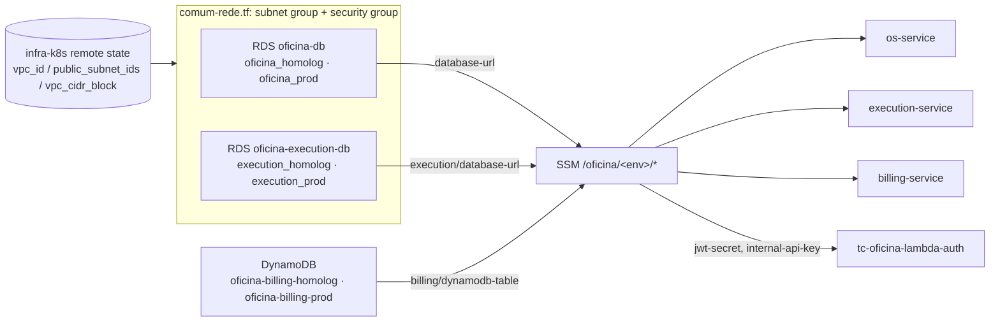

# tc-oficina-infra-db

Terraform da camada de dados dos microsserviços da oficina mecânica — Tech Challenge FIAP SOAT, grupo **Integradores**.

## Propósito ✱

Cada microsserviço tem o **seu** banco, e nenhum serviço acessa o banco de outro. Este repositório provisiona todos eles num só lugar (recuperação rápida de um reset da conta AWS Academy) e entrega a cada serviço só o que é dele, via SSM Parameter Store:

- **os-service** — RDS PostgreSQL `oficina-db` com os bancos `oficina_homolog` e `oficina_prod`.
- **execution-service** — RDS PostgreSQL próprio `oficina-execution-db` com os bancos `execution_homolog` e `execution_prod` e credencial própria.
- **billing-service** — DynamoDB `oficina-billing-homolog` e `oficina-billing-prod`.
- Segredos compartilhados por ambiente: `jwt-secret` (assinatura dos JWTs) e `internal-api-key` (chamadas serviço→serviço).

Os arquivos Terraform são organizados por dono: `os-*.tf`, `execution-*.tf`, `billing-*.tf` e `comum-*.tf` (rede dos RDS e segredos compartilhados). É um único root module de propósito: mover recursos para módulos mudaria seus endereços no state e o Terraform recriaria os bancos.

Este repositório lê o remote state do `tc-oficina-infra-k8s` (VPC/subnets), então **infra-k8s precisa estar aplicado primeiro**. Nenhum outro repositório lê o state daqui — a integração é só via SSM.

## Tecnologias ✱

- Terraform ≥ 1.10 (CI/CD fixam 1.15.9; `use_lockfile` no backend S3)
- Providers: `hashicorp/aws` (RDS, DynamoDB, security group, SSM), `cyrilgdn/postgresql` (bancos lógicos, um provider por instância), `hashicorp/random` (senha do RDS do execution, JWT, chave interna)
- Backend remoto: S3 `tc-fiap-oficina-tfstate-512135631497`, key `fase-3/infra-db.tfstate`
- GitHub Actions — CI (`fmt`/`validate`/`plan`) e CD (`apply`)

## Mapa de dados por serviço ✱

| Serviço (dono) | Recurso | Parâmetro SSM | Tipo | Lido por |
| --- | --- | --- | --- | --- |
| os-service | RDS `oficina-db` → bancos `oficina_<env>` | `/oficina/<env>/database-url` | SecureString | CD do os-service |
| execution-service | RDS `oficina-execution-db` → bancos `execution_<env>` | `/oficina/<env>/execution/database-url` | SecureString | CD do execution-service |
| billing-service | DynamoDB `oficina-billing-<env>` (`pk`/`sk`, GSI `gsi1`) | `/oficina/<env>/billing/dynamodb-table` | String | CD do billing-service |
| compartilhado | segredo JWT (64 caracteres) | `/oficina/<env>/jwt-secret` | SecureString | CDs dos 3 serviços, Lambda de autenticação |
| compartilhado | chave de API interna (48 caracteres) | `/oficina/<env>/internal-api-key` | SecureString | CD do os-service, CD do execution-service, Lambda de autenticação |

`<env>` = `homolog` | `prod`. Mensageria (SNS/SQS) e o hostname dos LoadBalancers são publicados no SSM por outros repositórios (`tc-oficina-infra-k8s` e os CDs dos serviços).

## Arquitetura deste repositório ✱



### Trade-offs (conta AWS Academy)

- **RDS público** (`publicly_accessible = true`, security group libera 5432 para a VPC e para `0.0.0.0/0`): sem bastion/VPN no Learner Lab, o provider `postgresql` durante o apply e os pipelines precisam alcançar os bancos pela internet. Em produção: só VPC + bastion.
- **Rede compartilhada entre os dois RDS**: mesma fronteira de rede; o isolamento entre serviços é por instância e por credencial (a senha do execution é gerada pelo Terraform e nunca é a mesma do os-service).
- **Apply em duas etapas**: os providers `postgresql` dependem do endereço das instâncias. O CD aplica primeiro `aws_db_instance.main` e `aws_db_instance.execution` (`-target`) e depois o resto — sem efeito quando já existem, necessário com state vazio.
- **`prevent_destroy`** nos dois RDS e nas tabelas DynamoDB: um plan que os recrie falha em vez de apagar dados. Para destruir de propósito, remover o bloco `lifecycle` num PR.
- **Sem recuperação de dados**: `skip_final_snapshot = true`, sem backup retido nos RDS e sem PITR no DynamoDB. Aceitável no sandbox acadêmico, não em produção.

## Como executar localmente ✱

Pré-requisitos:

1. Sessão ativa do AWS Academy Learner Lab com credenciais no ambiente.
2. `TF_VAR_db_password` com a senha do usuário `oficina` (mesmo valor do secret `TF_VAR_DB_PASSWORD`). A senha do RDS do execution é gerada pelo Terraform — não há variável para ela.
3. `tc-oficina-infra-k8s` aplicado.

```bash
export TF_VAR_db_password="<mesma senha do secret TF_VAR_DB_PASSWORD>"
terraform init
terraform plan
```

Com state vazio: `terraform apply -target=aws_db_instance.main -target=aws_db_instance.execution` e depois `terraform apply`.

## Deploy ✱

- **CI** (`.github/workflows/ci.yml`): todo PR para `main` e `develop`. `terraform fmt -check`, `validate` (sem backend) e `plan` best-effort — o job fica verde mesmo se o plan falhar por credencial expirada, então confira a linha `Plan:` no log.
- **CD** (`.github/workflows/cd.yml`): merge de PR em `main` ou `workflow_dispatch`. Garante o bucket de state, `terraform init`, apply das instâncias RDS e apply completo.

Secrets: `AWS_ACCESS_KEY_ID`, `AWS_SECRET_ACCESS_KEY`, `AWS_SESSION_TOKEN` (Learner Lab, rotativos) e `TF_VAR_DB_PASSWORD`.

## Recriar o ambiente inteiro (`scripts/subir-tudo.sh`)

Depois de um reset da conta do lab, recria tudo disparando os CDs na ordem certa e esperando cada um terminar:

1. `tc-oficina-infra-k8s` e `tc-oficina-infra-db` (sempre a partir de `main` — a infraestrutura é única para os dois ambientes);
2. por ambiente: `tc-oficina-os-service` → `tc-oficina-billing-service` → `tc-oficina-execution-service` → `tc-oficina-lambda-auth` (a Lambda/API Gateway lê do SSM o hostname do LoadBalancer de cada serviço, por isso vem por último).

```bash
# Git Bash / Linux; exige gh autenticado e AWS CLI com a sessão atual do lab
./scripts/subir-tudo.sh homolog            # develop -> homolog
./scripts/subir-tudo.sh prod               # main -> prod
./scripts/subir-tudo.sh todos              # os dois
./scripts/subir-tudo.sh todos --simular    # só verifica pré-requisitos e mostra a sequência
```

Antes de disparar qualquer coisa o script confere: `gh` autenticado, `aws sts get-caller-identity`, `cd.yml` com `workflow_dispatch` na branch alvo de cada repositório e secrets `AWS_*` atualizados há menos de 4 horas (senão, rodar `scripts/aws-academy-refresh.ps1` no `tc-oficina-os-service`). `--pular-ausentes` segue sem os repositórios que ainda não têm pipeline de deploy.

## Links ✱

- **Deploy ativo:** endpoints = outputs do `terraform apply` / console RDS e DynamoDB (conta AWS Academy, disponível com o lab ligado). Não há endpoint HTTP neste repositório.
- **Swagger / Collection:** não se aplica (repositório de infraestrutura).
- **Demais repositórios:**
  [`tc-oficina-os-service`](https://github.com/FIAP-POS-TECH-SOFTWARE-ARCHITECTURE/tc-oficina-os-service) ·
  [`tc-oficina-billing-service`](https://github.com/FIAP-POS-TECH-SOFTWARE-ARCHITECTURE/tc-oficina-billing-service) ·
  [`tc-oficina-execution-service`](https://github.com/FIAP-POS-TECH-SOFTWARE-ARCHITECTURE/tc-oficina-execution-service) ·
  [`tc-oficina-lambda-auth`](https://github.com/FIAP-POS-TECH-SOFTWARE-ARCHITECTURE/tc-oficina-lambda-auth) ·
  [`tc-oficina-infra-k8s`](https://github.com/FIAP-POS-TECH-SOFTWARE-ARCHITECTURE/tc-oficina-infra-k8s)

## Grupo Integradores

| Nome | RM |
| --- | --- |
| Lucas Gardini Dias | 372237 |
| Thiago Aio | 372238 |
